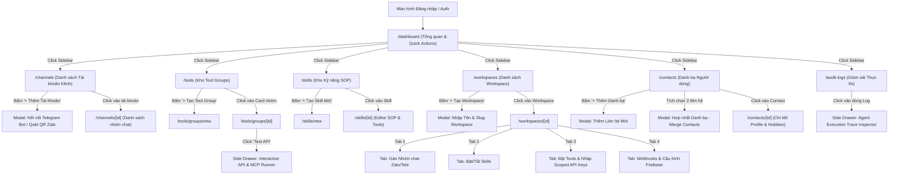

# 03. Danh sách Màn hình, Bố cục & Thiết kế UI (Screens, Navigation & UI Specs)

## 1. Cấu trúc Phân cấp & Sơ đồ Điều hướng Màn hình (Information Architecture & Screen Flow)

Toàn bộ ứng dụng Quản trị Web (Next.js App Router) tuân thủ Design System tối giản, hiện đại dựa trên **Tailwind CSS + Shadcn UI** với cơ chế chuyển đổi Dark/Light Mode.

### 1.1. Bảng Kiểm kê & Trạng thái Tiến độ Màn hình (Screen Inventory & Implementation Status)

Bảng theo dõi tiến độ tổng thể của toàn bộ giao diện dự án:

| Mã SCR | Tên Màn hình | Tuyến đường (Route) | Trạng thái Thiết kế | Trạng thái Code | Đường dẫn File Mã nguồn (`apps/web`) | Tiêu chuẩn Nghiệm thu (DoD) |
| :--- | :--- | :--- | :---: | :---: | :--- | :---: |
| **SCR-01** | Dashboard Tổng quan | `/admin/dashboard` | `APPROVED` | `DONE` | `src/app/admin/dashboard/page.tsx` | 4 Cards thống kê & Feed tin nhắn thời gian thực |
| **SCR-02** | Quản lý Kênh Kết nối | `/admin/channels` | `APPROVED` | `DONE` | `src/app/admin/channels/page.tsx` | Modal Bot Telegram & Modal quét mã QR Zalo |
| **SCR-03** | Kho Tool Groups & MCP | `/admin/tools` | `APPROVED` | `DONE` | `src/app/admin/tool-groups/page.tsx` | Danh sách ToolGroup, Import MCP & Test Drawer |
| **SCR-04** | Kho Kỹ năng (Skills) | `/admin/skills` | `APPROVED` | `DONE` | `src/app/admin/skills/page.tsx` | Quản lý SOP, System Prompt & Gán Tools |
| **SCR-05** | Workspace Hub | `/admin/workspaces/[id]` | `APPROVED` | `DONE` | `src/app/admin/workspaces/[id]/page.tsx` | 4 Tabs: Nhóm Chat, Skills, Scoped Vault, Webhooks |
| **SCR-06** | Quản lý Danh bạ (Contacts) | `/admin/contacts` | `APPROVED` | `TODO` | *Cần tạo:* `src/app/admin/contacts/page.tsx` | Bảng Contacts, Auto-link badge & Modal Merge |
| **SCR-07** | Giám sát Audit & Tracing | `/admin/audit-logs` | `APPROVED` | `DONE` | `src/app/admin/audit-logs/page.tsx` | Lọc theo Kênh, Workspace, Drawer Agent Trace |

### 1.2. Bản đồ Đường dẫn (Sitemap)

```text
/
├── /dashboard                    # Màn hình 1: Tổng quan hệ sinh thái & Thống kê
├── /channels                     # Màn hình 2: Quản lý Tài khoản & Kết nối Kênh (Telegram, Zalo)
│   └── /channels/[id]            # Chi tiết tài khoản & danh sách nhóm chat đã đồng bộ
├── /tools                        # Màn hình 3: Kho Tool Groups & Tool APIs Master
│   ├── /tools/groups/new         # Tạo mới Tool Group
│   └── /tools/groups/[id]        # Chi tiết Tool Group, cấu hình biến động & danh sách Tool con
├── /skills                       # Màn hình 4: Kho Kỹ năng (Skill Catalog & SOP)
│   └── /skills/[id]              # Chi tiết Skill, System Prompt, Tool Dependencies
├── /workspaces                   # Màn hình 5: Quản lý Không gian Làm việc (Workspace Hub)
│   └── /workspaces/[id]          # Cấu hình chi tiết Workspace (Tabs: Kênh, Skills, Scoped Tools, Webhooks)
├── /contacts                     # Màn hình 6: Quản lý Danh bạ Toàn cầu (Global Contacts)
│   └── /contacts/[id]            # Chi tiết hồ sơ cá nhân, lịch sử tương tác, Workspace trực thuộc
└── /audit-logs                   # Màn hình 7: Giám sát Thực thi & Tracing Agent
```

### 1.3. Sơ đồ Điều hướng Người dùng (Screen Flowchart)
Sơ đồ mô tả cơ chế chuyển trang, mở Modal pop-up hoặc Side-Drawer giữa các màn hình:




---

## 2. Chi tiết Từng Màn hình & Layout Specifications

### Màn hình 1: Dashboard Tổng quan (`/dashboard`)
* **Layout:** Top Header (Stats ticker, Workspace Switcher, User Profile), Main Grid:
  * **Card Metrics (4 cột):** Tổng số Workspace hoạt động, Số kênh đang kết nối (Telegram/Zalo), Tổng số Tool APIs sẵn sàng, Lượng tin nhắn xử lý trong 24h.
  * **Live Activity Feed:** Bảng hiển thị 10 tin nhắn gần nhất qua các kênh, trạng thái xử lý (Success, Running, Error), độ trễ (latency).
  * **Quick Actions:** Nút "Thêm Kênh Chat Mới", "Tạo Tool Group", "Tạo Workspace Mới", "Mở Danh bạ".

---

### Màn hình 2: Quản lý Tài khoản Kênh (`/channels`)
* **Layout:**
  * **Header:** Tiêu đề "Kênh Liên Lạc", nút "Thêm Tài Khoản Mới" (mở Modal chọn Telegram Bot hoặc Zalo).
  * **Modal Kết nối Telegram:** Input nhập `Bot Token`, nút "Kiểm tra & Kết nối", hiển thị tên Bot (@BotName) sau khi xác thực.
  * **Modal Kết nối Zalo:** Tabs: (1) Quét mã QR (hiển thị mã QR động tạo từ backend `zca-js` với countdown 60s), (2) Nhập Zalo OA Token & Webhook Secret.
  * **Data Table Danh sách Tài khoản:** Cột Tên tài khoản, Nền tảng (Badge Telegram/Zalo), Trạng thái kết nối (Badge xanh Active / đỏ Disconnected), Số lượng nhóm chat đã tham gia, Nút "Đồng bộ nhóm mới (Refresh Groups)" và "Ngắt kết nối".

---

### Màn hình 3: Kho Tool Groups & Tool APIs (`/tools`)
* **Layout:**
  * **Trang danh sách Tool Groups:** Dạng lưới (Card Grid) hiển thị từng hệ thống tích hợp (ví dụ: "OmniAgent Internal Management (MCP)", "Haravan Order API", "KiotViet Inventory", "Internal CRM").
  * **Chi tiết Tool Group (`/tools/groups/[id]`):**
    * *Thẻ Cấu hình Chung:* Tên nhóm, Key, Base URL, Protocol Type (`REST` hoặc `MCP`), Auth Type mặc định (`Bearer Token`, `API Key`, `None`), Danh sách biến động yêu cầu (Tags: `API_KEY`, `TENANT_ID`).
    * *Bảng Danh sách Tools Con:* Danh sách endpoint hoặc MCP function (Badge HTTP Method: `GET`, `POST`, `MCP Tool`), Tên Tool, Đường dẫn (`/v1/orders`), Trạng thái hoạt động, Nút "Test Tool" (mở Drawer chạy thử với JSON input và xem kết quả thực tế).

---

### Màn hình 4: Kho Kỹ năng (`/skills`)
* **Layout:**
  * **Danh sách Skills:** Bảng quản lý các quy trình nghiệp vụ đã tạo (ví dụ: "Tra cứu Đơn hàng", "Tạo Báo giá Nhanh", "Hỗ trợ Kỹ thuật cấp 1").
  * **Trang Chi tiết / Tạo mới Skill:**
    * *Form thông tin:* Tên, Key, Mô tả ngắn.
    * *Bộ kích hoạt (Trigger Intents):* Nhập danh sách câu mẫu hoặc từ khóa để Router Agent nhận diện.
    * *System Prompt (SOP):* Code editor Monaco/Textarea cho phép định nghĩa cách Agent phản hồi, các bước suy nghĩ và tiêu chuẩn nghiệm thu câu trả lời.
    * *Required Tools:* Danh sách Checkbox chọn các Tool APIs mà Skill này được phép sử dụng.

---

### Màn hình 5: Quản lý Workspace (`/workspaces/[id]`)
* **Layout:** Header chứa thông tin Workspace (Tên, Mã định danh, Nút Lưu). Bên dưới chia thành 4 Tabs nghiệp vụ:
  * **Tab 1: Kênh & Nhóm Chat (Channels & Chat Groups):**
    * Cây danh mục phân theo từng tài khoản Telegram / Zalo.
    * Danh sách các nhóm chat (Group Name, Chat ID) kèm Checkbox.
  * **Tab 2: Phân quyền Kỹ năng (Skills):**
    * Danh sách tất cả Skills trong hệ thống kèm Switch Toggle Bật/Tắt cho Workspace.
  * **Tab 3: Phân quyền Công cụ & Scoped Data (Tools & Scoped Config):**
    * Danh sách các Tool Groups (bao gồm cả ToolGroup Internal MCP). Khi bật Switch kích hoạt:
      * Tự động mở rộng form nhập **Dynamic Variables Overrides** dành riêng cho Workspace (ô nhập `API_KEY`, `BRANCH_ID` có mask bảo mật).
      * Danh sách các Tool con bên trong kèm Checkbox để tắt/bật ngoại lệ từng API.
  * **Tab 4: Inbound Webhooks & Firebase FCM:**
    * Quản lý Secret Token Webhook cho Mobile App/Website kết nối vào Agent.
    * Form upload cấu hình `serviceAccountKey.json` đẩy thông báo Firebase.

---

### Màn hình 6: Quản lý Danh bạ Toàn cầu (`/contacts`)
* **Layout:**
  * **Top Filter Bar:** Ô tìm kiếm theo Tên, Nickname, Số điện thoại, Email; Bộ lọc theo Workspace; Nút "+ Thêm Danh bạ" và nút "Hợp nhất (Merge)".
  * **Data Table Danh bạ:**
    * Cột Thông tin cá nhân: Avatar, Tên đầy đủ, Biệt danh (`nickname`), Giới tính (`nam`/`nữ`), Năm sinh.
    * Cột Định danh kênh: Badge Zalo ID, Badge Telegram ID.
    * Cột Quyền hạn: Badge `USER` (xám) hoặc `SUPER_ADMIN` (đỏ cam nổi bật).
    * Cột Không gian làm việc: Danh sách các Workspace trực thuộc (Badge nhỏ).
    * Cột Thao tác: Sửa thông tin, Gán Workspace, Xóa.
  * **Modal Hợp nhất Danh bạ (Merge Contacts Modal):**
    * Cho phép chọn 1 Contact làm **Hồ sơ chính (Primary)** và 1 Contact làm **Hồ sơ phụ (Secondary)**.
    * Bảng so sánh trực quan dữ liệu trước khi bấm xác nhận gộp.

---

### Màn hình 7: Giám sát Thực thi (`/audit-logs`)
* **Layout:**
  * Bảng lọc theo: Thời gian, Workspace, Kênh (Telegram/Zalo), Trạng thái (Success/Failed/Rejected).
  * Khi click vào một dòng log, mở **Side Drawer (Agent Trace Inspector)**:
    1. *User Prompt:* Tin nhắn gốc của người dùng.
    2. *Router Decision:* Intent phân loại được, Skill đã chọn (hoặc danh mục Tool đã gán).
    3. *Worker Reasoning:* Suy nghĩ từng bước (Chain-of-thought) của Worker Agent.
    4. *Tool Execution Steps:* Từng lệnh gọi Tool, URL đầy đủ (đã inject biến), Payload gửi đi, HTTP Response Status và Body nhận về.
    5. *Final Bot Output:* Câu trả lời cuối cùng đã gửi về nhóm chat.

---

## 3. Ma trận 4 Trạng thái Giao diện (UI States Matrix)

Mọi màn hình và thành phần dữ liệu trong ứng dụng đều bắt buộc phải triển khai đầy đủ 4 trạng thái giao diện theo chuẩn UX:

| Màn hình / Thành phần | 1. Loading State (Đang nạp) | 2. Empty State (Chưa có dữ liệu) | 3. Error State (Gặp lỗi tải) | 4. Success State (Chuẩn) |
| :--- | :--- | :--- | :--- | :--- |
| **Dashboard Metrics** | 4 thẻ Skeleton xám nhấp nháy (`animate-pulse`) với kích thước tương ứng. | Hiển thị các ô chỉ số giá trị `0` kèm gợi ý "Hãy kết nối kênh đầu tiên". | Thẻ hiển thị viền đỏ mờ, dòng text "Lỗi tải thống kê" + Nút icon Refresh. | Hiển thị số liệu thực tế kèm % tăng trưởng so với tuần trước. |
| **Kênh chat (`/channels`)** | Bảng Skeleton 3 dòng mô phỏng các cột dữ liệu. | Illustration minh họa icon Telegram/Zalo xám + Nút lớn "Kết nối Kênh Chat Đầu Tiên". | Banner thông báo "Mất kết nối tới Redis/Gateway" + Nút "Thử lại". | Danh sách các tài khoản với badge trạng thái Xanh lá/Đỏ. |
| **Kho Tools (`/tools`)** | Grid 6 ô thẻ card nhấp nháy mô phỏng layout dạng lưới. | Icon hộp rỗng + Dòng chữ "Chưa có Tool Group nào" + Nút "Nhập từ MCP" hoặc "Tạo thủ công". | Card báo lỗi "Không thể kết nối CSDL công cụ". | Lưới các Tool Group hiển thị đầy đủ logo, tên và số lượng endpoint. |
| **Workspace (`/workspaces/[id]`)** | Skeleton dạng tabs và cây checkbox danh mục. | N/A (Mỗi tab đều có giá trị mặc định). | Thông báo lỗi "Không tìm thấy Workspace này hoặc đã bị xóa" + Nút "Quay về danh sách". | Form đầy đủ dữ liệu cấu hình và trạng thái toggle bật/tắt. |
| **Danh bạ (`/contacts`)** | Table Skeleton 5 dòng với placeholder tròn cho avatar. | Hình minh họa sổ địa chỉ trống + Chữ "Danh bạ chưa có ai" + Nút "+ Thêm người đầu tiên". | Thông báo "Lỗi tải dữ liệu người dùng" kèm mã lỗi HTTP 500. | Bảng danh sách liên hệ đầy đủ bộ lọc, avatar và các badge định danh. |
| **Audit Log Drawer** | Cột mốc Timeline Skeleton mô phỏng 4 bước suy nghĩ. | (Không mở drawer nếu không có log). | Hiển thị badge FAILED màu đỏ tươi + Hộp code chứa thông tin StackTrace lỗi. | Timeline chi tiết từ Tin nhắn đến $\rightarrow$ Suy luận $\rightarrow$ Gọi API $\rightarrow$ Kết quả. |

---

## 4. Quy chuẩn Form & Validation Rules (Quy tắc Nhập liệu)

Tất cả các Form trên giao diện phải áp dụng xác thực Client-side (React Hook Form + Zod Schema) kèm Inline Validation (báo lỗi ngay dưới ô nhập khi Blur hoặc gõ sai):

| Form / Trường Nhập Liệu | Bắt buộc? | Ràng buộc Kỹ thuật & Validation Rule | Thông báo Lỗi Hiển thị (Error Message) |
| :--- | :---: | :--- | :--- |
| **Workspace Name** | Có | Độ dài: 3 – 50 ký tự; Không chứa ký tự đặc biệt ngoài `-` và `_`. | "Tên Workspace phải từ 3 đến 50 ký tự và không chứa ký tự đặc biệt." |
| **Workspace Slug** | Có | Định dạng: Chữ thường, số, dấu gạch nối (regex: `^[a-z0-9-]+$`); Unique toàn hệ thống. | "Slug chỉ được chứa chữ cái thường, số và dấu gạch nối (vd: hanoi-branch)." |
| **Telegram Bot Token** | Có | Regex chuẩn của Telegram BotFather: `^[0-9]{8,10}:[a-zA-Z0-9_-]{35}$`. | "Định dạng Bot Token không hợp lệ. Vui lòng lấy từ @BotFather." |
| **Tool Group Key** | Có | Chữ thường viết liền, dùng dấu gạch dưới (regex: `^[a-z0-9_]{3,30}$`). | "Mã khóa (Key) phải từ 3-30 ký tự và chỉ dùng chữ thường hoặc gạch dưới." |
| **Scoped API Key** | Tùy chọn | Masked ký tự mật khẩu (`type="password"`), có nút icon con mắt bật/tắt hiển thị. | "Vui lòng nhập khóa API hợp lệ nếu kích hoạt nhóm công cụ này." |
| **Contact: Họ và tên** | Có | Độ dài: 2 – 100 ký tự; Loại bỏ khoảng trắng thừa đầu cuối. | "Họ và tên không được để trống và tối thiểu 2 ký tự." |
| **Contact: Nickname** | Không | Độ dài: 1 – 30 ký tự (Ưu tiên tên ngắn để AI xưng hô). | "Biệt danh không được vượt quá 30 ký tự." |
| **Contact: Số điện thoại** | Không | Regex số điện thoại Việt Nam: `^(0[35789])[0-9]{8}$`. | "Số điện thoại không đúng định dạng di động Việt Nam (vd: 0912345678)." |
| **Contact: Email** | Không | Regex Email chuẩn: `^[^\s@]+@[^\s@]+\.[^\s@]+$`. | "Địa chỉ email không hợp lệ." |
| **Contact: Năm sinh** | Không | Số nguyên từ 1930 đến (Năm hiện tại - 5). | "Năm sinh không hợp lệ." |

---

## 5. Phân quyền Hiển thị Giao diện theo Vai trò (Role-based UI Visibility)

Giao diện áp dụng cơ chế phân quyền trực quan nhằm đảm bảo người dùng chỉ tương tác với các tính năng trong thẩm quyền:

```text
Chính sách:
- SUPER_ADMIN: Toàn quyền truy cập mọi màn hình, xem mọi dữ liệu và có nút bấm thao tác hủy hoại (Xóa, Gộp).
- USER / GUEST: Chỉ có quyền đọc thông tin, không thấy các nút cấu hình nhạy cảm.
```

| Nút bấm / Khu vực Giao diện | SUPER_ADMIN | USER / WORKSPACE MEMBER |
| :--- | :---: | :---: |
| **Nút "Tạo Workspace Mới"** | ✅ Hiển thị & Thao tác được | ❌ Ẩn hoàn toàn |
| **Nút "Xóa Workspace" (`DELETE`)** | ✅ Hiển thị (Yêu cầu gõ lại tên để xác nhận) | ❌ Ẩn hoàn toàn |
| **Bật/Tắt Tool Group Internal MCP** | ✅ Hiển thị & Kích hoạt được | ❌ Bị vô hiệu hóa (Disabled kèm tooltip) |
| **Xem Scoped API Keys (Giải mã)** | ✅ Bấm icon con mắt để xem rõ | ❌ Hiển thị dạng chấm đen `********` vĩnh viễn |
| **Nút "Hợp nhất Danh bạ (Merge Contacts)"** | ✅ Hiển thị & Kích hoạt Modal gộp | ❌ Ẩn hoàn toàn |
| **Nút "Sửa quyền thành viên (Chuyển thành Admin)"**| ✅ Có quyền thay đổi | ❌ Bị khóa |
| **Xem Audit Log Traces** | ✅ Xem chi tiết Payload & HTTP Response | ⚠️ Chỉ xem được Prompt & Câu trả lời cuối |

---

## 6. Prompts Thiết kế cho Google Stitch (English Prompts)

Dưới đây là các prompt chi tiết sẵn sàng sử dụng với công cụ thiết kế **Google Stitch MCP**:

### Stitch Prompt 1: Workspace Management & Scoped Config View
```text
Design a modern, high-density SaaS dashboard screen for "Workspace Configuration" in dark mode. 
Clean aesthetic inspired by Linear and Vercel. 
Top section: Breadcrumbs (Workspaces / "Hanoi Sales Office"), Workspace title, status badge (Active), and a primary "Save Changes" button.
Tab navigation bar with 4 tabs: "Connected Chat Groups", "Enabled Skills", "Tool Permissions & Scoped Credentials", and "Webhooks & Notifications".
Active tab shows "Tool Permissions & Scoped Credentials":
A card list of Tool Groups. The first card is "OmniAgent Internal Management (MCP)" with a red "Admin Only" badge and a green enabled toggle.
The second card is "KiotViet Inventory API" with a green enabled toggle.
Below the header of the card, an expandable "Workspace Scoped Variables" section containing two input fields with secure dot-masking: "API_KEY" (value: "kv_sec_********") and "BRANCH_ID" (value: "HN_STORE_01").
Inside the card, an indented table of individual endpoints: 
- Row 1: GET badge in green, "/api/products/search", Switch toggle ON.
- Row 2: POST badge in blue, "/api/orders/create", Switch toggle ON.
- Row 3: DELETE badge in red, "/api/products/{id}", Switch toggle OFF with a subtle "Restricted" tooltip.
Sidebar on the left with navigation items: Dashboard, Channels, Tool Catalog, Skill Catalog, Workspaces (active), Contacts, Audit Logs.
```

### Stitch Prompt 2: Global Contacts & Identity Directory Screen
```text
Design a sophisticated CRM Contacts Directory screen for an AI platform in dark mode.
Top section: Title "Global Contacts Directory" with a subtitle "Unified identity tracking across Zalo, Telegram and Workspaces".
Action bar: A prominent search input with icon "Search by name, nickname, phone or email...", a dropdown filter "All Workspaces", and two buttons: "Merge Profiles" (ghost button with merge icon) and "+ Add New Contact" (primary blue button).
Main content: High-density data table with columns:
1. Contact: Avatar with online ring, Name "Huy Nguyen", Nickname pill "anh Huy", gender/age pill "Male, 1992".
2. Platform Accounts: Badge row with blue Zalo icon ("zalo_88291") and paper-plane Telegram icon ("@huy_tech").
3. Role: Red-orange pill badge "SUPER_ADMIN".
4. Workspaces: Two stacked tag badges "Hanoi Sales Office", "DevOps Core".
5. Last Active: "2 mins ago via Zalo".
6. Actions: Ghost icon buttons for Edit, Link Workspace, and Trash.
Hover state on row shows subtle elevation and highlight.
```

### Stitch Prompt 3: Agent Execution Trace Inspector (Drawer View)
```text
Design an advanced AI Agent Execution Trace inspector drawer sliding from the right edge over an audit log data table.
Drawer title: "Execution Trace #TR-98421" with status badge "Success" in emerald and execution time "1.84s".
Metadata pill row: "Workspace: Marketing Team", "Channel: Zalo Group #growth-leads", "Model: Claude-3.5-Sonnet".
Content timeline:
1. Inbound Node: User avatar, text message "Check inventory for SKU-990 and notify if stock < 10".
2. Identity Node: Card "Identified Contact: Nam Tran (Nickname: anh Nam, Role: SUPER_ADMIN)".
3. Intent Classification Node: "Router: No matching skill found. Selected Tool Group: Inventory API".
4. Agent Thought Node: Collapsible card with icon of a lightbulb, containing monospace markdown text: "User requests stock verification for SKU-990. Calling Inventory API search endpoint with workspace scoped key...".
5. Tool Call Node: Expandable card titled "Call: GET /api/products/search?sku=SKU-990", Status 200 OK. Tabbed code viewer showing Request Headers (with injected bearer token) and JSON Response payload (`{ "sku": "SKU-990", "stock": 4 }`).
6. Outbound Response Node: Bot avatar, rich text preview: "Sản phẩm SKU-990 hiện chỉ còn 4 chiếc trong kho Hà Nội (dưới mức cảnh báo 10) anh Nam nhé.".
```
