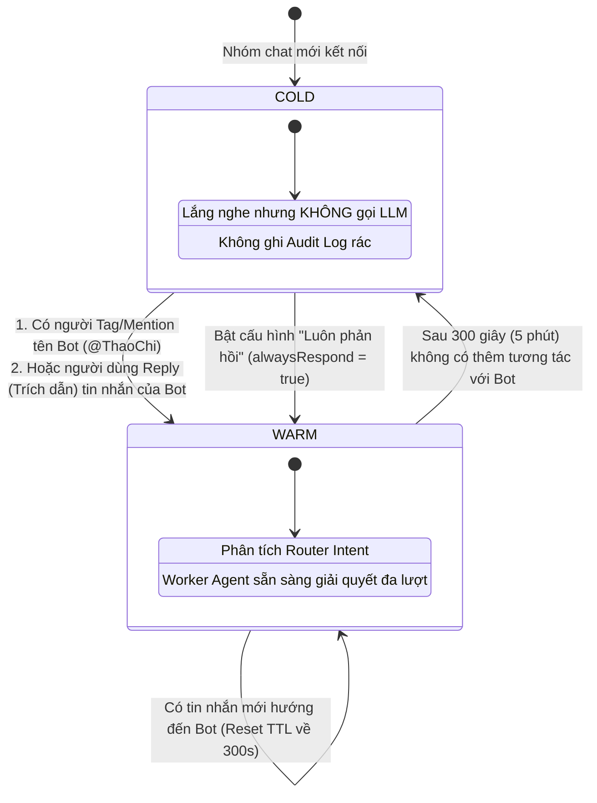
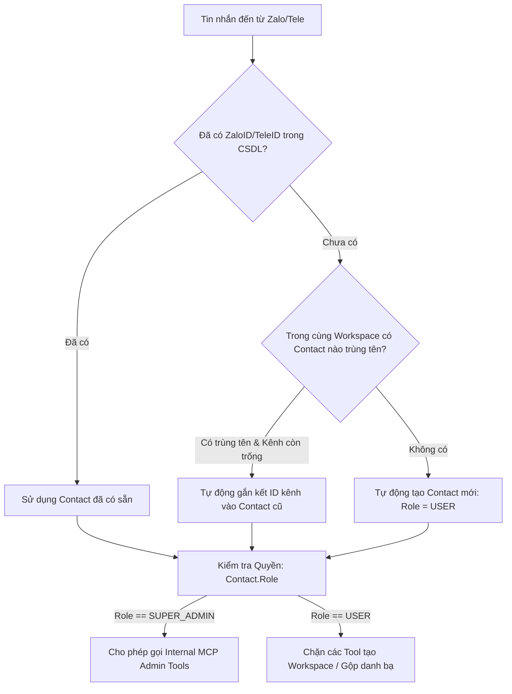
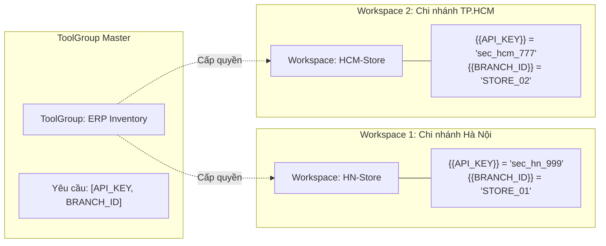
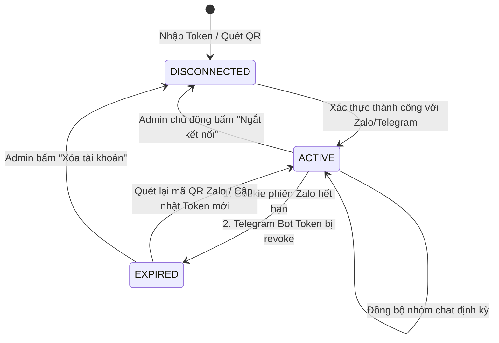
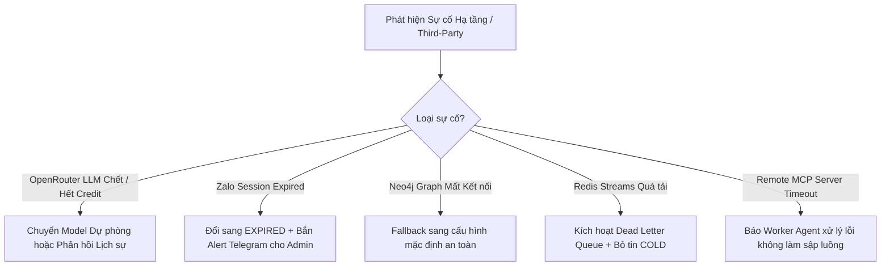

# 12. Đặc tả Quy tắc Nghiệp vụ & Máy Trạng thái (Business Rules & State Machines)

Tài liệu này định nghĩa toàn bộ các quy tắc logic nghiệp vụ ngầm (Business Constraints), máy trạng thái (State Machines) và các chính sách vận hành cốt lõi của nền tảng **OmniAgent Gateway**.

---

## 1. Máy Trạng thái Hội thoại Nhóm (Chat Session State Machine)

Để tránh tình trạng Bot AI xen ngang vào cuộc trò chuyện riêng tư của các thành viên trong nhóm chat Zalo/Telegram, hệ thống áp dụng cơ chế chuyển đổi trạng thái **COLD $\leftrightarrow$ WARM**:

### Các Quy tắc Nghiệp vụ Chi tiết:
*   **BR-SESS-01 (Mặc định im lặng):** Ở trạng thái **COLD**, nếu tin nhắn của người dùng trong nhóm KHÔNG nhắc đến tên Bot (ví dụ: "Thảo Chi", "Bot", "em ơi") và KHÔNG reply tin nhắn cũ của Bot $\rightarrow$ Hệ thống lập tức bỏ qua, không tốn Token và không ghi log.
*   **BR-SESS-02 (Thời gian sống của phiên WARM - TTL):** Khi phiên chuyển sang **WARM**, thời gian duy trì là **300 giây (5 phút)** lưu trong Redis Cache (`chat_session:{platform}:{chat_id}`). Mỗi khi Bot trả lời thành công một câu hỏi, bộ đếm 300s được làm mới (Reset).
*   **BR-SESS-03 (Chế độ Always Respond):** Nếu Quản trị viên kích hoạt cờ `alwaysRespond = true` cho nhóm chat trên Dashboard, Bot sẽ bỏ qua bộ lọc COLD và luôn luôn phân tích mọi tin nhắn trong nhóm.

---

## 2. Quy tắc Định danh & Quản lý Danh bạ (Global Contacts & Identity Rules)

### Các Quy tắc Nghiệp vụ Chi tiết:
*   **BR-ID-01 (Định danh Duy nhất):** `zalo_id` và `telegram_id` là các khóa duy nhất (Unique) trên toàn bộ hệ thống. Một ID ứng dụng chat chỉ được thuộc về đúng một Contact.
*   **BR-ID-02 (Nhận diện Trùng tên Thông minh trong cùng Workspace):** Nếu một người dùng chat từ tài khoản Telegram mới, nhưng trong cùng Workspace đó đã tồn tại một Contact có cùng Tên (không phân biệt hoa thường) và trường `telegram_id` của họ đang để trống $\rightarrow$ Hệ thống tự động suy luận họ là cùng một người và gán `telegram_id` mới vào Contact có sẵn.
*   **BR-ID-03 (Quy tắc Xưng hô Tên chính - Given Name):**
    *   Agent tuyệt đối KHÔNG gọi cả họ và tên đệm (vd: *Không gọi "anh Nam Trần", "chị Nguyễn Thu Trang"*).
    *   Hệ thống tự động trích xuất tên chính: "Nam Trần" $\rightarrow$ "anh Nam"; "Thu Trang" $\rightarrow$ "chị Trang".
    *   Nếu bản ghi Contact có trường **`nickname`**, Agent bắt buộc phải ưu tiên sử dụng `nickname` để xưng hô.
*   **BR-ID-04 (Quy tắc Hợp nhất Danh bạ - Merge Contacts):**
    *   Chỉ `SUPER_ADMIN` mới có quyền kích hoạt lệnh hợp nhất danh bạ (hoặc AI ra lệnh thay mặt SuperAdmin).
    *   Khi hợp nhất: Giữ nguyên ID của **Contact Chính (Primary)**; chuyển toàn bộ các thông tin còn thiếu (SĐT, Email, Giới tính, Năm sinh, Sở thích) từ **Contact Phụ (Secondary)** sang Primary.
    *   Nếu Contact Phụ có Role là `SUPER_ADMIN` $\rightarrow$ Contact Chính tự động được nâng cấp lên `SUPER_ADMIN`.
    *   Toàn bộ liên kết Neo4j `(:Contact)-[:BELONGS_TO]->(:Workspace)` của Contact Phụ được chuyển giao cho Contact Chính trước khi xóa bỏ hoàn toàn Contact Phụ.

---

## 3. Ràng buộc Không gian làm việc & Bảo mật Biến Scoped (Workspace Scoped Vault)

### Các Quy tắc Nghiệp vụ Chi tiết:
*   **BR-WS-01 (Phân vùng Nhóm Chat):** Một nhóm chat (`ChannelChat`) chỉ được thuộc về **DUY NHẤT một Workspace** tại một thời điểm. Không cho phép gán 1 nhóm chat vào nhiều Workspace khác nhau để tránh xung đột ngữ cảnh.
*   **BR-WS-02 (Mã hóa Cấu hình Riêng biệt):** Mọi giá trị biến động (`API_KEY`, `TOKEN`, `PASSWORD`) lưu trong bảng `workspace_tool_configs` bắt buộc phải được mã hóa bằng thuật toán **AES-256-GCM** với Master Key từ biến môi trường `ENCRYPTION_KEY`.
*   **BR-WS-03 (Ưu tiên Biến Không gian - Override Hierarchy):** Khi thực thi một Tool API, giá trị biến được resolve theo thứ tự ưu tiên giảm dần:
    1.  *Ưu tiên 1:* Biến Workspace Scoped Vault được giải mã từ PostgreSQL (`workspace_tool_configs`).
    2.  *Ưu tiên 2:* Biến Workspace Data lưu trên đồ thị Neo4j `(Workspace)-[:HAS_DATA]->(Data)`.
    3.  *Ưu tiên 3:* Biến mặc định của ToolGroup Master `(ToolGroup)-[:HAS_DATA]->(Data)`.

---

## 4. Vòng đời Trạng thái Kênh Kết nối (Channel Account Lifecycle)

### Các Quy tắc Nghiệp vụ Chi tiết:
*   **BR-CHAN-01 (Healthcheck Chủ động):** Background Worker thực hiện ping kiểm tra trạng thái token của tất cả tài khoản `ACTIVE` định kỳ **60 giây/lần**.
*   **BR-CHAN-02 (Xử lý khi Hết hạn):** Nếu Zalo báo lỗi `SessionExpired` (mã lỗi 1002 từ `zca-js`) hoặc Telegram báo lỗi `401 Unauthorized` $\rightarrow$ Hệ thống tự động chuyển trạng thái sang `EXPIRED`, gửi thông báo cảnh báo lên UI Dashboard và ngừng nhận tin nhắn cho đến khi Admin quét lại QR.

---

## 5. Xử lý Lỗi, Giới hạn Thời gian (Timeouts) & Thử lại (Retries)

| Tác vụ / Giao dịch | Giới hạn Thời gian (Timeout) | Chính sách Thử lại (Retry Policy) | Hành động khi Thất bại Cuối cùng (Fallback Action) |
| :--- | :--- | :--- | :--- |
| **Router Agent Phân loại** | **5 giây** | Không thử lại (Tránh trễ) | Chuyển thẳng về chế độ `FLEXIBLE_REACT` mặc định cho Worker Agent. |
| **Worker Agent Suy luận** | **30 giây** | 1 lần nếu LLM trả về mã lỗi 503/429 | Gửi tin nhắn xin lỗi: *"Hệ thống AI đang quá tải, vui lòng thử lại sau giây lát."* |
| **Gọi API Tool Bên thứ ba** | **15 giây** (Hoặc theo cấu hình ToolGroup) | Không tự động thử lại các method có tính thay đổi dữ liệu (`POST`, `PUT`, `DELETE`) | Báo lỗi lịch sự: *"Không thể kết nối đến hệ thống đối tác vào lúc này."* và ghi trạng thái `FAILED` vào `audit_logs`. |
| **Inbound Webhook Callback** | **10 giây** | **3 lần** (Exponential Backoff: sau 2s, 10s, 30s) | Đánh dấu `callback_status = 'CALLBACK_FAILED'`, kích hoạt cảnh báo hệ thống. |
| **Internal MCP Thao tác Quản trị** | **10 giây** | 0 lần | Trả về thông báo lỗi chi tiết cho AI để AI giải thích cho Admin. |

---

## 6. Ma trận Giảm tải & Đối phó Sự cố (Failure Mode & Graceful Degradation Matrix)

Khi các hạ tầng hoặc bên thứ ba gặp sự cố nghiêm trọng, hệ thống không bao giờ được phép "chết lặng" (Silent Crash) mà bắt buộc phải suy giảm tính năng một cách êm đẹp (Graceful Degradation) theo ma trận sau:

### Chi tiết Kịch bản Xử lý Từng Sự cố:

| Tình huống Sự cố (Incident) | Dấu hiệu Nhận diện | Hành vi Suy giảm An toàn (Graceful Degradation) | Câu Phản hồi Người dùng (User-facing Message) | Kênh Cảnh báo Admin (Alert Channel) |
| :--- | :--- | :--- | :--- | :--- |
| **1. OpenRouter sập / Hết hạn mức (429 / 500 / Insufficient Credits)** | HTTP status 429, 402 hoặc 503 từ OpenRouter API | 1. Tự động chuyển thử nghiệm sang Model phụ (Fallback Model: Gemini Flash sang DeepSeek/OpenAI nếu có cấu hình). 2. Nếu toàn bộ LLM fail: Không lặp lại vòng lặp. | *"Dạ em xin lỗi anh/chị, kết nối đến trí tuệ nhân tạo tạm thời bị gián đoạn. Anh/chị vui lòng thử lại sau ít phút ạ!"* | Gửi tin nhắn khẩn cấp tới Telegram của SuperAdmin kèm mã lỗi. |
| **2. Phiên Zalo Cá nhân Hết hạn (Expired Cookie)** | `zca-js` trả về mã lỗi 1002 (`SessionExpired`) hoặc mất WebSocket connection | 1. Ngay lập tức đổi trạng thái tài khoản trong DB sang `EXPIRED`. 2. Dừng tiếp nhận tin nhắn từ Zalo để tránh spam lỗi. 3. Hiển thị thông báo đỏ trên Web Dashboard. | Không gửi tin nhắn vào nhóm (đã mất quyền gửi). | Bắn thông báo qua Telegram SuperAdmin: *"⚠️ Tài khoản Zalo [Tên] đã hết hạn phiên. Vui lòng mở Dashboard quét lại mã QR!"* |
| **3. Đồ thị Neo4j Tạm thời Mất kết nối** | Neo4j Driver ném `ServiceUnavailable` hoặc Connection Timeout > 3s | 1. Không cho phép thực thi các Tool nhạy cảm. 2. Áp dụng chính sách Fail-Safe: Chỉ cho phép hỏi đáp thông tin cơ bản không can thiệp CSDL. 3. Tự động thử reconnect sau mỗi 30s. | *"Hệ thống đang bảo trì dữ liệu phân quyền trong giây lát. Em sẽ phản hồi anh/chị ngay khi kết nối ổn định ạ!"* | Ghi log mức độ `CRITICAL` và kích hoạt Webhook cảnh báo máy chủ. |
| **4. Redis Streams Bị Quá Tải / Tắc Nghẽn (Backpressure)** | Hàng đợi `stream:inbound_messages` tồn đọng $> 1,000$ messages chưa xử lý | 1. Áp dụng chính sách Shedding (Xả tải): Tự động loại bỏ các tin nhắn thuộc trạng thái **COLD** (không tag bot). 2. Ưu tiên xử lý tin nhắn có tag `@Bot` và tin từ SuperAdmin. 3. Các tin lỗi được đẩy vào `stream:dead_letter_queue` để xử lý lại sau. | Phản hồi bình thường cho các tin được ưu tiên; các tin bị drop không kích hoạt LLM. | Cảnh báo trạng thái quá tải lên widget giám sát hệ thống. |
| **5. Remote MCP Server Bên Ngoài Timeout (> 15s)** | Worker Agent gọi tool MCP nhưng không có phản hồi sau 15 giây | 1. Ngắt kết nối socket tool an toàn (AbortController). 2. Trả kết quả lỗi vào mảng Observation của Agent: `{"error": "MCP_SERVER_TIMEOUT"}`. 3. Worker Agent tiếp tục suy nghĩ và giải thích cho người dùng thay vì sập luồng. | *"Dạ em đã cố gắng tra cứu dữ liệu từ hệ thống [Tên MCP], nhưng máy chủ bên đó phản hồi quá chậm. Em sẽ thử lại sau ạ!"* | Ghi trạng thái `TIMEOUT` vào bảng `audit_logs`. |

